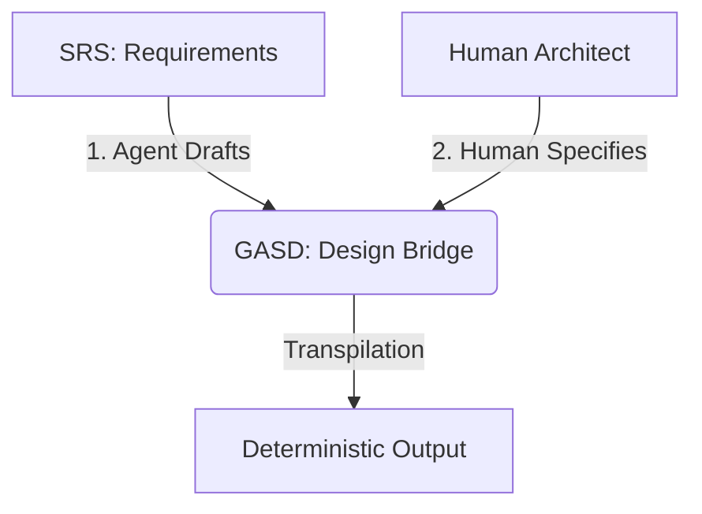

# GASD 1.2.0 — Official Authoritative General Agentic Software Design Language

GASD is a **Design Bridge Language** that connects upstream Requirements (SRS) to downstream Implementation (Code).

## Core Concept: The Deterministic Bridge

GASD does not contain requirements, and it does not contain implementation code. It captures **Design Decisions** and **Implementation Constraints** so that an AI agent produces **identical code every time**.

### Integration with Agile

For GASD to coexist with user-story driven development (Agile), it must not replace user stories — it must sit downstream of them. With GASD, you insert a deterministic design bridge:

`Epic` → `User Stories` → `Acceptance Criteria` → `SRS` (optional formalization layer) → `GASD` (deterministic architecture spec) → `Transpiled Code`

It supports two collaboration paths:

1. **Agent-First**: Agent drafts GASD from an SRS → Human reviews/modifies.
2. **Human-First**: Human specifies the design in GASD → Agent implements the code.

Standard natural language allows for "Agent Drift" — where the AI makes different implementation choices each time. GASD eliminates this through a strict constraint system, providing an unambiguous bridge for AI-human collaboration.

- **Lock down Architecture**: Use `DECISION` blocks to choose libraries, strategies, and patterns.
- **Lock down Data**: Use `TYPE` contracts with `@annotations` for validation and formatting.
- **Lock down Logic**: Use `FLOW` and `STRATEGY` with `@error_strategy` to define the steps and algorithms without writing raw code.
- **Strict Compliance**: Fully RFC 2119 compliant (MUST, SHALL, SHOULD) for both human specifications and AI interpretations.

## Documentation

- The formal grammar and conformance rules are in the [specification](GASD_Specification.md).
- The machine-readable metamodel includes standard annotation definitions and environmental assumptions. [Self-definition](gasd-1.2.0.gasd)
- Learn the language with the [tutorial](GASD_Tutorial.md).
- Browse the [GASD 1.2 examples](../examples/gasd-1.2), including the [user management service](../examples/gasd-1.2/user_management_v1_2.gasd) and the [multi-file order workflow](../examples/gasd-1.2/multi-file).
- Read the rationale for the Design Bridge in the [Design Principles](../Design_Principles.md).

## Getting Started

1. Draft a design from your user stories or software requirements specification. Begin the file with `VERSION 1.2` and set a `TARGET` for implementation.
2. Review the design decisions, validate the interface contracts, and identify evidence for the expected outcomes.
3. Provide the reviewed design to your implementation agent or transpiler.

---

## Changelog

### Version 1.2.0

- **Formal semantics, contract modeling, and verification.** Adds the `VERSION` directive, `POSTCONDITION` for `ACHIEVE`, `CONTRACT` blocks at `IMPORT` boundaries, `DEPENDS_ON` step mappings, scoped `INVARIANT`s, environmental `ASSUMPTION`s, `MODEL` references for TLA+ and Alloy, and `AS` obligation identifiers for annotations. It defines 12 lint rules and describes annotation semantics in terms of structural predicates, runtime contracts, and environmental dependencies. [GEP-6](../GEPS/GEP-6%3A%20GASD%201.2%20%E2%80%94%20Formal%20Semantics%2C%20Contract%20Modeling%2C%20and%20Verification%20Support)
- **Contract validation and case guards.** Contracts must match the interface signature and declare at least one behavior case. Each case must specify a `POSTCONDITION` or `THROWS`, and `LINT-007` flags missing cases or outcomes. Optional `WHEN` guards determine which cases apply to the supplied inputs. A verifier checks the observed outcome against eligible cases and reports it as unverified when a case could match but evidence is missing. [GEP-7](../GEPS/GEP-7%3A%20GASD%201.2%20Contract%20Validation%20and%20Case%20Guards.md) · [Contract rules and guarded example](GASD_Specification.md#61-contract-modeling--contract-gasd-12-addition)

The bundled inventory service shows success and failure cases for `release_stock`, including the observable effect of a repeated release. [Inventory service example](../examples/gasd-1.2/multi-file/inventory_service.gasd)

GEP-7 records that `gasd_parser` 2.1.6 accepted guarded contracts while omitting `WHEN` guards from the AST. The proposal lists guard preservation, stricter static validation, and runtime call checks as follow-up work.

### Version 1.1.0

- **Literal Types** (via GEP-2): Specify that a field must match an exact string or number, enabling discriminant fields, strict state transitions, and constant values. See the [Tutorial](../GASD-1.1/GASD_Tutorial.md) and [Specification](../GASD-1.1/GASD_Specification.md) for details.
- **Formalized Flow Keywords** (via GEP-3): Explicitly defines `TRANSFORM`, `ON_ERROR`, `THROW`, `UPDATE`, and `APPLY` to support deterministic mutations and error handling. See the [Specification](../GASD-1.1/GASD_Specification.md#flow-keywords) for details.
- **Grammar Flexibility, Pattern Matching, and Resources** (via GEP-4): Expands identifier syntax for requirements traceability (e.g., `#AC-1`), allows permissive math expressions in actions, enhances `MATCH` with `CONTAINS` and OR patterns, and formalizes the `RESOURCES` definition block.
- **Mandatory Explicit VALIDATE AS TYPE Binding** (via GEP-5): Requires `VALIDATE expr AS TYPE.TypeName` on every validation step, establishing explicit TYPE→FLOW binding for deterministic annotation enforcement. See the [Specification](../GASD-1.1/GASD_Specification.md#53-annotation-enforcement-via-validate-binding) for details.

---
