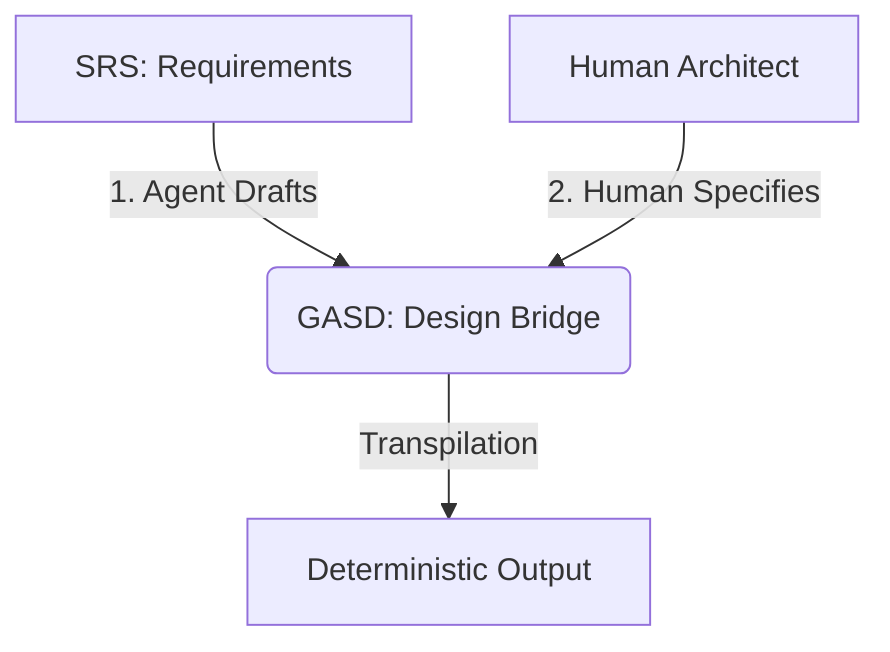

# General Agentic Software Design (GASD) Language

Welcome to the official repository for **GASD** — the Official Authoritative General Agentic Software Design Language.

GASD is a **Design Bridge Language** that connects upstream Requirements (SRS) to downstream Implementation (Code).

## Specifications and Versions

GASD is an evolving standard. The specifications and tutorials are organized by version, and the bundled examples target GASD 1.2.

* **[GASD 1.2 (Latest)](./GASD-1.2/README.md)**
  * Formalizes language semantics and adds interface contracts and verification support. [GEP-6](./GEPS/GEP-6%3A%20GASD%201.2%20%E2%80%94%20Formal%20Semantics%2C%20Contract%20Modeling%2C%20and%20Verification%20Support)
  * Defines contract validation, optional `WHEN` guards on behavior cases, and how to check observed calls. [GEP-7](./GEPS/GEP-7%3A%20GASD%201.2%20Contract%20Validation%20and%20Case%20Guards.md)
* **[GASD 1.1](./GASD-1.1/README.md)**
  * Includes GEP-2 (Literal Types).
  * Includes GEP-3 (Missing Flow Keywords: TRANSFORM, ON_ERROR, THROW, UPDATE, APPLY).
  * Includes GEP-4 (Grammar Flexibility, Pattern Matching, and Resource Specification).
  * Includes GEP-5 (Mandatory Explicit VALIDATE AS TYPE Binding).
* **[GASD 1.0 (Baseline)](./GASD-1.0/README.md)**
  * The initial release of the language.

---

## Core Concept: The Deterministic Bridge

GASD does not contain requirements, and it does not contain implementation code. It captures **Design Decisions** and **Implementation Constraints** so that an AI agent produces **identical code every time**.

### Integration with Agile

For GASD to coexist with user-story driven development (Agile), it must not replace user stories — it must sit downstream of them. With GASD, you insert a deterministic design bridge:

`Epic` → `User Stories` → `Acceptance Criteria` → `SRS` (optional formalization layer) → `GASD` (deterministic architecture spec) → `Transpiled Code`

It supports two collaboration paths:

1. **Agent-First**: Agent drafts GASD from an SRS → Human reviews/modifies.
2. **Human-First**: Human specifies the design in GASD → Agent implements the code.

Standard natural language allows for "Agent Drift" — where the AI makes different implementation choices each time. GASD eliminates this through a strict constraint system, providing an unambiguous bridge for AI-human collaboration.

* **Lock down Architecture**: Use `DECISION` blocks to choose libraries, strategies, and patterns.
* **Lock down Data**: Use `TYPE` contracts with `@annotations` for validation and formatting.
* **Lock down Logic**: Use `FLOW` and `STRATEGY` with `@error_strategy` to define the steps and algorithms without writing raw code.
* **Lock down Architecture**: Use `DECISION` blocks to choose libraries, strategies, and patterns.
* **Lock down Data**: Use `TYPE` contracts with `@annotations` for validation and formatting.
* **Lock down Logic**: Use `FLOW` and `STRATEGY` with `@error_strategy` to define the steps and algorithms without writing raw code.
* **Strict Compliance**: Fully RFC 2119 compliant (MUST, SHALL, SHOULD) for both human specifications and AI interpretations.

## GASD Ecosystem

The GASD language is supported by a growing ecosystem of tools and resources:

* **[GASD Blog](https://general-agentic-software-design.github.io/)**: Read about the "why" behind GASD and the detailed reasoning for the Design Bridge philosophy.
* **[VS Code Extension](https://github.com/General-Agentic-Software-Design/gasd-vscode-extension)**: Get expert-level support in your editor with syntax highlighting, IntelliSense, real-time diagnostics, and Mermaid visualizations.
* **[GASD Parser & Validator](https://github.com/General-Agentic-Software-Design/GASD-Parser-Validator)**: The canonical tool for ensuring your designs are 100% compliant. Use it in **Self-Verification Loops** to eliminate AI hallucinations and design drift.

## Documentation (Version Specific)

* Read the normative rules and formal grammar in the [GASD 1.2 specification](./GASD-1.2/GASD_Specification.md).
* Explore the machine-readable [GASD 1.2 self-definition](./GASD-1.2/gasd-1.2.0.gasd).
* Learn the language with the [GASD 1.2 tutorial](./GASD-1.2/GASD_Tutorial.md).
* Browse standalone and multi-file designs in the [GASD 1.2 examples](./examples/gasd-1.2).
* Read the rationale for the Design Bridge in the [Design Principles](./Design_Principles.md).

## Getting Started

1. **Draft**: Provide your User Stories or SRS (Software Requirements Specification) to an AI agent to generate an initial GASD design.
2. **Review & Refine**: Humans review the GASD file for architectural correctness, security, and specific constraints.
3. **Generate**: Provide the finalized GASD to the agent with a `TARGET` (e.g., Python, Rust) to get production-ready, consistent code.

---
